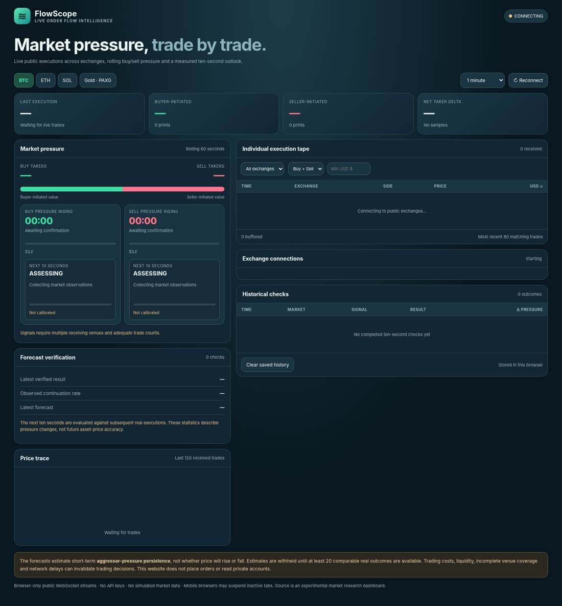
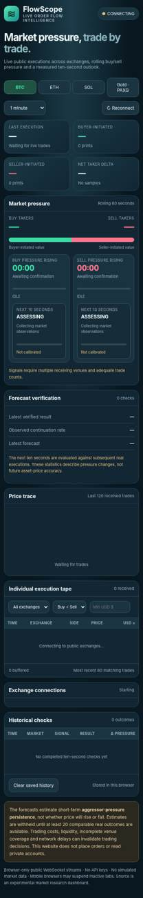

# FlowScope

**A clearer view of real-time market order flow.**

FlowScope is a free, mobile-friendly research terminal for individual, publicly reported crypto executions. It brings live venue activity, buy-versus-sell taker pressure, independent ten-second observations, and data-quality diagnostics into one view.

[Open the live terminal](https://flowscope-live-tape-maan-0a06.vercel.app)

## Screenshots





*Interface screenshots were captured with no live market connection. They are not simulated market data or historical performance results.*

## Multi-timeframe analysis

Pressure, dominance streak, and 10-second scenario context have independent timeframe selectors. The comparison matrix supports 15s, 30s, 1m, 3m, 5m, 15m, 30m, and 1h. Longer windows require actual elapsed collection time and sufficient venue health; incomplete windows display warmup instead of implying complete historical coverage. The master consensus uses only complete qualified windows and warns when shorter and longer windows disagree. The views are correlated and are **not** independent predictions or financial advice.

## Current research release

FlowScope separates live USD and USDT market calculations, normalizes execution timestamps, monitors venue freshness and concentration, and provides a multi-timeframe market-pressure console. A conflict-aware BOSS summary abstains when qualified selected windows disagree.

The current research interface includes quote-specific reference prices, venue-level attribution, price-response statistics, 10-second forward flow observations, experimental price-direction labels, empirical confidence intervals, and a majority-direction baseline. Statistics require real future observations and do not establish a profitable strategy. Browser-side data collection may pause in background or sleep.

This repository mirrors the currently deployed Vercel production source. No broker trading functionality or private API credentials are included.

## Highlights

- Public trade feeds from Binance, Coinbase Exchange, Kraken, OKX, Bybit, Gate.io, Bitstamp and Bitget, with status indicators for feeds that are unavailable or not receiving data.
- BTC, ETH, SOL and PAXG spot-market views. PAXG is tokenized gold and is not the OTC XAU/USD gold market.
- Exchange-aware prices: the displayed reference is labeled **Binance `ASSET/USDT`**, not a consolidated market price. Execution rows keep each venue's original USD or USDT quote unit.
- Trade-event timestamps displayed in the visitor's local timezone with milliseconds, plus measured arrival lag and feed freshness.
- Pressure computed using **all accepted trade messages in second-level aggregates**, even when the visible tape is capped to preserve browser performance.
- Clear distinction between **dominance** (which side is stronger) and **momentum** (how that balance has changed). A green streak cannot count as buy dominance while sellers lead the window.
- A single BUY, SELL, or WAIT ten-second outlook. Predictions are evaluated against a **non-overlapping future interval**; the engine never records an artificial opposite-side prediction at the same timestamp.
- Historical forecast verification in local browser storage. Empirical rates remain hidden until a sufficient sample of matching observed outcomes exists.
- Automatic WebSocket reconnection, stale-feed warnings, duplicate trade-ID filtering, and no user accounts or exchange API keys.

## Start locally

This project is plain HTML, CSS and JavaScript. No build tool or server-side account credentials are required.

```bash
python -m http.server 8080
```

Then open [http://localhost:8080](http://localhost:8080).

### Test the calculations

Node.js 20+ is recommended:

```bash
npm test
npm run check
```

The calculation tests cover timestamp rejection, separate dominance/momentum, rolling windows, volume aggregation under a capped trade tape, and directional forecast verification.

## Understanding the model

A trade always has both a buyer and seller. "Buy pressure" means buying is the **aggressive taker side** of observed public executions. It does not identify traders or reveal every order submitted to an exchange.

```text
Buy-share (%) = aggressive buy notional / (aggressive buy + aggressive sell notional) × 100
Taker delta   = aggressive buy notional − aggressive sell notional
```

For each permitted ten-second assessment, FlowScope examines the preceding two non-overlapping ten-second observations and a broader trend baseline. It also requires recent trades from more than one venue and basic agreement across those venues. If the evidence is insufficient, the model **abstains**.

A completed assessment is compared with the following ten-second flow window. A 2-percentage-point deadband classifies small changes as *flat*. Flat/invalid labels are not silently counted as correct predictions. Empirical continuation percentages are withheld until enough comparable outcomes have accumulated.

**These are experimental pressure forecasts, not backtested price predictions.** A valid pressure prediction does not establish a profitable trading strategy.

## Limitations worth knowing

- Some public WebSocket endpoints are blocked or restricted by region, product, device or network.
- Browser sessions cannot guarantee uninterrupted collection when a phone sleeps or a tab is backgrounded; missing periods are never filled with made-up trades.
- USD and USDT quote assets are different. Their venue prices and price charts should not be treated as identical. Cross-venue notionals are approximate USD equivalents, not FX-converted dollar accounting.
- Market quality indicators and estimated accuracy require historical out-of-sample validation before operational use.
- A high number of individual executions is not necessarily the number of distinct orders or users.
- This project **does not connect to a broker, place orders, or provide financial advice**.

## Project structure

```text
index.html                   Dashboard structure
src/styles.css               Responsive terminal design
src/app.js                   WebSocket adapters, state and UI
src/engine.js                Pure market calculations
tests/engine.test.js        Node tests for calculation rules
 docs/screenshots/           Desktop and mobile interface captures
vercel.json                  Static deployment configuration
```

## Maintainer

**Inderjeet Singh Maan** · [GitHub](https://github.com/inderjeetsmaan)

The project is published under the terms in [`LICENSE`](LICENSE).